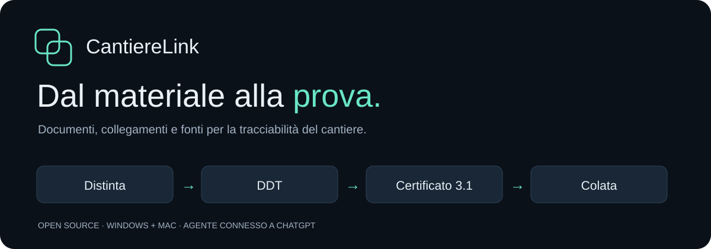
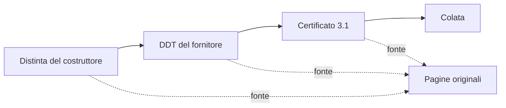
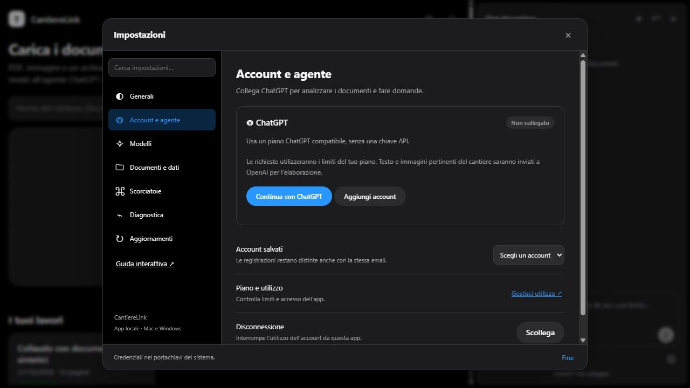
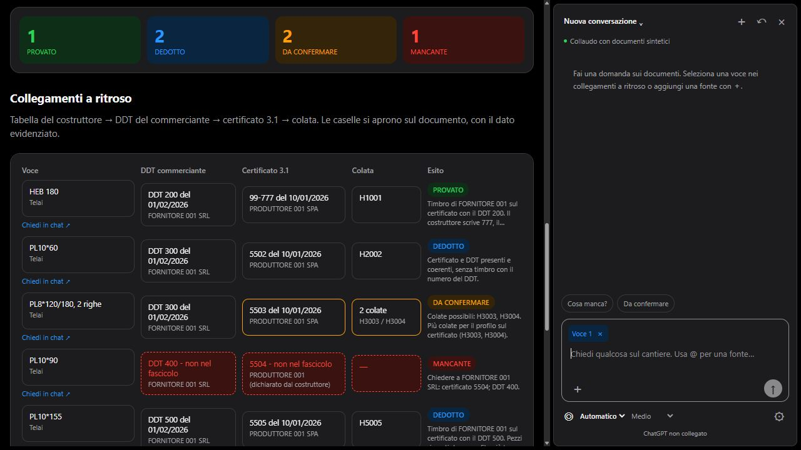

# CantiereLink



Dai documenti di cantiere alla tracciabilità dei materiali da carpenteria metallica. CantiereLink collega distinta, documento di trasporto (DDT), certificato 3.1 e colata. Ogni risultato mantiene il rimando alle pagine usate per ricostruirlo.

[Guida interattiva](https://nick919191.github.io/cantiere-link/docs/) · [Scarica l’app](https://github.com/nick919191/cantiere-link/releases/tag/v0.3.0) · [Installazione](#installazione) · [Primo cantiere](#il-primo-cantiere) · [Aggiornamenti](#aggiornamenti) · [Licenza](#licenza) · [Contatti](#contatti)

La guida HTML include una catena documentale esplorabile, istruzioni Windows/Mac, schermate, percorso guidato e lettura vocale facoltativa. Puoi consultarla online, scaricare il progetto e aprire `docs/index.html`, oppure scegliere Guida interattiva nell’app. Il README qui sotto resta leggibile direttamente su GitHub, con sezioni espandibili.

Versione 0.3.0 in anteprima, destinata alla valutazione. Consulta gli allegati della release per i pacchetti disponibili. Gli installer non hanno una firma di distribuzione; l’accesso ChatGPT con un account reale e il collaudo completo sui sistemi supportati restano da completare. Inizia con documenti di prova.

## A cosa serve

- Raccogliere PDF, immagini e archivi ZIP in un cantiere.
- Leggere e classificare distinta, DDT, certificati, dichiarazioni e allegati.
- Ricostruire i collegamenti fra materiale, fornitore, certificato e colata.
- Distinguere prove, deduzioni, ambiguità e documenti mancanti.
- Interrogare le pagine dalla chat laterale e aprire le fonti della risposta.
- Esportare Excel, prove e documenti riordinati.

È pensata per studi di ingegneria, imprese e carpenterie che controllano fascicoli documentali. Il risultato aiuta la verifica tecnica; non certifica la conformità dei materiali e non sostituisce il controllo degli originali.



## Installazione

La distribuzione per utenti finali usa un installer `.exe` su Windows e un pacchetto `.dmg` su Mac. Python e librerie sono inclusi: non occorre installarli separatamente. L’interfaccia si apre nel browser locale, senza un sito remoto a cui caricare il cantiere. Serve Internet per collegare l’agente e analizzare i documenti.

<details open>
<summary>Windows — installer</summary>

1. Scarica [CantiereLink-Setup-0.3.0.exe](https://github.com/nick919191/cantiere-link/releases/download/v0.3.0/CantiereLink-Setup-0.3.0.exe).
2. Apri il file e completa l’installazione per il tuo utente.
3. Apri CantiereLink dal menu Start. Puoi aggiungere un collegamento sul desktop.
4. Per arrestare il servizio locale usa Impostazioni → Chiudi applicazione. Chiudere soltanto la scheda del browser non arresta il servizio.

L’installer di anteprima non è firmato digitalmente. Firma e verifica completa dell’installazione sui sistemi supportati restano da completare prima di un rilascio stabile. La disinstallazione rimuove il programma e conserva i cantieri nella cartella dati.

</details>

<details>
<summary>macOS — pacchetto .dmg</summary>

1. Scegli `CantiereLink-VERSIONE-macos-arm64.dmg` per Apple Silicon o `CantiereLink-VERSIONE-macos-x86_64.dmg` per Intel.
2. Apri il pacchetto e trascina CantiereLink in Applicazioni.
3. Apri l’app e collega ChatGPT dalle impostazioni.

I pacchetti Mac vengono compilati su macOS: consulta gli allegati della release per la disponibilità di ciascuna architettura. Firma Developer ID, notarizzazione e collaudo interattivo nativo restano da completare.

</details>

<details>
<summary>Sviluppatori — avvio dai sorgenti ZIP</summary>

Installa Python 3.12 o successivo da [python.org](https://www.python.org/downloads/). Estrai lo ZIP del codice in una cartella stabile. Su Windows apri `Avvia.bat`; su macOS esegui `bash avvia.sh` da un Terminale nella cartella. Il primo avvio installa le dipendenze nella `.venv` locale. Mantieni aperto il terminale durante il lavoro; `Ctrl+C` arresta il servizio.

</details>

<details>
<summary>Collegare ChatGPT</summary>

Apri Impostazioni → Account e agente → Continua con ChatGPT. Completa l’accesso nel browser e autorizza l’utilizzo del piano. Puoi conservare più registrazioni e scegliere l’account attivo.



Il collegamento segue [Sign in with ChatGPT per applicazioni open source locali](https://developers.openai.com/siwc/token-sharing-open-source). Non occorrono una chiave API o un programma esterno per l’agente. Le richieste consumano i limiti del piano; disponibilità e condizioni dipendono dal servizio. Le credenziali restano nel portachiavi del sistema.

</details>

## Il primo cantiere

1. Inserisci un nome e carica PDF, immagini o ZIP.
2. Attendi la preparazione locale delle pagine, poi premi Analizza / riprendi.
3. Segui il diario. Le letture accettate vengono conservate; quelle non valide restano da verificare.
4. Apri i collegamenti a ritroso e confronta i dati con le pagine originali.
5. Seleziona Chiedi in chat su una voce, oppure aggiungi pagine con `+` e formula una domanda precisa.
6. Scarica Excel e prove o i documenti riordinati.



Le schermate e la [demo esplorabile](demo/tracciabilita-demo.html) usano documenti inventati. La demo simula anche le risposte e il collegamento ChatGPT. L’app reale richiede un account collegato per analisi e chat.

| Esito | Significato |
|---|---|
| PROVATO | Collegamento sostenuto dalle prove documentali richieste dal motore. |
| DEDOTTO | Documenti coerenti, collegamento ottenuto per deduzione. |
| DA CONFERMARE | Ambiguità o evidenza incompleta: serve verifica. |
| MANCANTE | Documento richiesto non presente nel fascicolo letto. |

<details>
<summary>Limiti da conoscere prima di usare i risultati</summary>

- Una pagina viene richiesta una volta per ogni avvio dell’analisi. Non sono previsti tentativi aggiuntivi nascosti. Premi Riprendi per le pagine non accettate.
- Un fascicolo non letto completamente produce esiti provvisori. L’assenza di un documento non è accertata se alcune pagine restano irrisolte.
- La presenza di una citazione nella trascrizione non prova che una scansione sia stata letta correttamente. Controlla l’immagine originale.
- La chat consulta al massimo otto pagine pertinenti per domanda. Puoi indicare una voce e selezionare le fonti. Le risposte non cambiano stati, documenti o Excel.
- Le letture conservano versione delle istruzioni, modello e data. Le precedenti elaborazioni restano nella cartella `versioni` del cantiere.
- Caricamento massimo: 500 MiB. Archivi: massimo 2.000 elementi, 1 GB espanso, tre livelli di annidamento.

</details>

## Aggiornamenti

L’app controlla le release stabili di `nick919191/cantiere-link` quando è aperta, al massimo una volta al giorno. Il controllo contatta GitHub senza inviare documenti o credenziali ChatGPT. Puoi disattivarlo in Impostazioni → Aggiornamenti o premere Controlla adesso.

Quando una nuova release è disponibile:

1. Compare un avviso dentro l’app. Non sono richieste notifiche di sistema.
2. Puoi leggere le novità, scegliere Installa aggiornamento o Più tardi.
3. L’app verifica provenienza e impronta SHA256 del pacchetto. Per gli utenti dell’installer scarica il file adatto al sistema; Apri installer avvia la procedura e chiude CantiereLink.
4. Completa la procedura e riapri CantiereLink. Su Mac sostituisci l’app in Applicazioni. Nell’avvio da sorgenti vengono invece verificati anche il manifest e le dipendenze in una cartella separata; riapri il consueto Avvia.

Interfaccia e programma vengono aggiornati insieme. I cantieri non vengono spostati, eliminati o riscritti dall’installazione. L’aggiornamento diventa attivo solo dopo la preparazione riuscita. Se fallisce, la versione in uso resta disponibile.

La versione 0.3.0 è una release preliminare: il controllo automatico la esclude, perché propone soltanto release stabili. Un commit o un tag da soli non producono un aggiornamento installabile.

<details>
<summary>Tornare alla versione precedente</summary>

Per la versione installata, conserva e usa l’installer della release precedente. Il ripristino non annulla modifiche ai dati.

Solo nell’avvio da sorgenti: scegli Impostazioni → Aggiornamenti → Torna alla precedente, poi chiudi e riapri Avvia. Il ripristino riguarda il programma e non annulla modifiche ai dati.

Se la nuova versione non parte, apri un terminale nella cartella originale ed esegui:

```text
# Windows
python avvia.py --versione-originale

# macOS
python3 avvia.py --versione-originale
```

Da questa copia puoi aprire le impostazioni e selezionare la versione precedente. Non cancellare la cartella originale di avvio. Le future release che cambieranno il formato dei dati dovranno documentare compatibilità, backup e migrazione.

</details>

<details>
<summary>Per chi mantiene il progetto: preparare una release</summary>

1. Esegui i test e verifica il collegamento dell’account sulle piattaforme supportate.
2. Aggiorna `version` in `pyproject.toml` usando tre numeri, per esempio `0.4.0`.
3. Controlla `release.json`: repository `nick919191/cantiere-link`, prefisso asset `cantiere-link`. Mantieni questi valori coerenti fra le versioni.
4. Esegui `python tools/package_release.py`.
5. Controlla lo ZIP prodotto: contiene solo sorgenti, guida e demo sintetica, senza `.git`, `.venv`, cantieri o credenziali.
6. Compila gli installer con `python tools/build_installer.py` su Windows e su ciascuna architettura Mac. Su Windows serve Inno Setup 6; installa anche PyInstaller. Il workflow manuale `.github/workflows/installers.yml` produce artefatti senza pubblicare release.
7. Quando decidi di pubblicare, crea su GitHub una release stabile con tag `v0.4.0`. Allega `cantiere-link-0.4.0.zip` e il file `.zip.sha256`, inserendo note di rilascio comprensibili.
8. Allega anche gli installer `CantiereLink-Setup-VERSIONE.exe` e `CantiereLink-VERSIONE-macos-ARCH.dmg` con i loro checksum.
9. Verifica che GitHub riporti il campo `digest` SHA256 per l’asset. L’updater rifiuta asset senza questa verifica. Il file di checksum allegato serve anche al controllo manuale.

L’app usa l’API [GitHub Releases](https://docs.github.com/en/rest/releases/releases#get-the-latest-release) e non installa direttamente il contenuto di un branch. La verifica SHA256 controlla l’integrità del pacchetto ricevuto dal repository configurato; non è una firma indipendente del produttore.

</details>

## Eliminare e ripristinare un cantiere

Nella schermata iniziale premi Elimina sul cantiere, poi conferma Sposta nel cestino. Il cantiere scompare dai lavori, conservando originali, risultati e conversazioni. Per recuperarlo apri Cestino e premi Ripristina. Una preparazione o un’operazione dell’agente in corso impedisce la rimozione.

Il cestino è recuperabile: continua a occupare spazio su disco. Non elimina la cache condivisa delle letture. Non è prevista una cancellazione definitiva automatica.

## Documenti e riservatezza

Originali, risultati e conversazioni restano sul computer. Testo e immagini pertinenti vengono inviati a OpenAI quando avvii analisi o chat. Non si tratta di un modello interamente offline. L’app non usa un proprio server centrale; le richieste al modello usano `store: false`.

| Sistema | Cartella dati predefinita |
|---|---|
| Windows | `%LOCALAPPDATA%\TracciabilitaMateriali\dati` |
| macOS | `~/Library/Application Support/TracciabilitaMateriali/dati` |
| Linux | `~/.local/share/tracciabilita-materiali/dati` |

Il nome tecnico della cartella resta invariato per conservare la compatibilità con le versioni precedenti. La posizione effettiva compare in Impostazioni → Documenti e dati. Le nuove versioni installate dall’updater risiedono nella cartella `aggiornamenti/installazioni`, accanto alle preferenze.

Le credenziali usano Gestione credenziali Windows o Portachiavi macOS; su Linux serve Secret Service. Non sono incluse nei report o nello ZIP. La disconnessione tenta la revoca remota e cancella i token locali, segnalando eventuali problemi di revoca.

<details>
<summary>Configurazione delle cartelle e compatibilità</summary>

- `TRACCIA_RADICE` cambia la radice dei dati.
- `TRACCIA_CONFIG` cambia la cartella delle preferenze e delle installazioni gestite.
- `TRACCIA_PORTA` cambia la porta locale.
- Per riprendere un precedente archivio con `lavori/` e `archivio/` dentro il progetto, imposta `TRACCIA_RADICE` a quella cartella. Nessun archivio viene spostato automaticamente.
- La guida vocale usa una voce italiana locale, se disponibile nel browser. In assenza della voce, la trascrizione resta consultabile.

</details>

## Licenza

La licenza attuale è [MIT](LICENSE), adatta a consentire adozione, modifica e integrazione anche in ambito aziendale. Chi distribuisce il software deve conservare avvisi di copyright e licenza. La MIT consente anche derivati proprietari e non impone la pubblicazione delle modifiche. [Condizioni MIT](https://choosealicense.com/licenses/mit/).

Se l’obiettivo cambia, le alternative da valutare sono:

| Licenza | Quando sceglierla |
|---|---|
| MIT | Vuoi facilitare il riuso, anche commerciale e proprietario. |
| Apache 2.0 | Vuoi una licenza permissiva con concessione esplicita sui brevetti dei contributori e obblighi su avvisi e modifiche. |
| AGPL v3 | Vuoi la condivisione del codice alle condizioni della licenza, anche agli utenti di una versione modificata offerta come servizio in rete. |

[Apache 2.0](https://choosealicense.com/licenses/apache-2.0/) · [AGPL v3](https://choosealicense.com/licenses/agpl-3.0/). Tutte e tre consentono l’uso commerciale. Questo confronto è orientativo: il testo della licenza disciplina i diritti. Una diversa licenza va scelta prima del rilascio, verificando i diritti sui contributi e sulle dipendenze. I documenti caricati dagli utenti non diventano open source.

## Sviluppo e verifiche

```text
python -m venv .venv
# Attiva l’ambiente con il comando previsto dal tuo sistema.
python -m pip install -r requirements.txt pytest ruff
python -m pytest -q
ruff check traccia tests tools avvia.py
ruff format --check traccia tests tools avvia.py
```

`traccia/` contiene il servizio e il motore, `web/` l’interfaccia, `docs/` la guida, `istruzioni/` le regole di lettura e `conoscenza/` il metodo. `avvia.py` è l’avvio stabile che seleziona la versione installata. La CI è configurata per Windows, macOS e Linux.

I test automatici usano risposte simulate. L’accesso con un account reale, il ciclo completo con una release GitHub pubblicata e il collaudo nativo su macOS restano da verificare. La configurazione della CI non dimostra che quei collaudi siano già riusciti.

I comandi CLI e `.claude/` restano strumenti opzionali per il flusso precedente. Richiedono `TRACCIA_RADICE` impostata alla cartella del progetto e non vanno eseguiti contemporaneamente all’agente ChatGPT sullo stesso lavoro.

Gli esempi usano identificatori neutri: Produttore 001, Fornitore 001, Costruttore 001. Prima della pubblicazione verifica anche la cronologia Git: l’anonimizzazione del pacchetto non riscrive autori e commit precedenti.

## Contatti

Nicola Silvestre · [ni.silvestre91@gmail.com](mailto:ni.silvestre91@gmail.com)

Per informazioni, problemi e proposte. Non inviare credenziali o documenti riservati. CantiereLink è un progetto indipendente, non affiliato a OpenAI.
